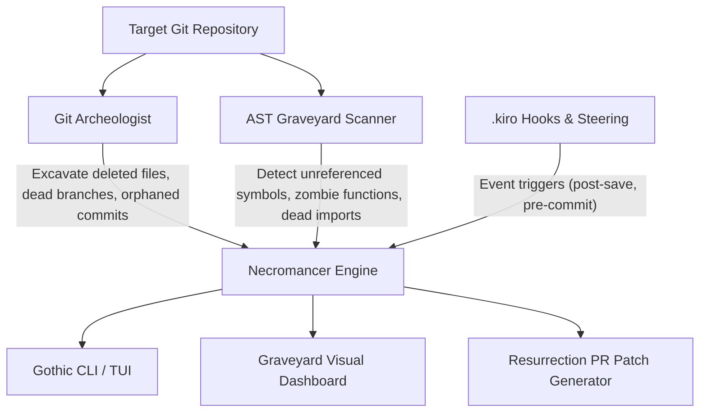

# GraveDigger: System Architecture & Steering Context

## 1. Project Mission & Identity
GraveDigger is an agentic codebase necromancer built for the **Kiroween Hackathon (Frankenstein Track)**. It stitches together a chimera of disparate systems:
1. Low-level **Git Forensic Plumbing** (`rev-list`, `diff-tree`, log archeology, reflog excavation).
2. Static **Abstract Syntax Tree (AST)** graph analysis for Python & polyglot codebases.
3. Autonomous **Kiro Agent Hooks & Steering Workflows** for spec-driven code resurrection.
4. An interactive **Gothic Terminal User Interface (TUI)** and **Graveyard Web Dashboard**.

## 2. Core Subsystems

## 3. Guiding Principles
* **Zero Disruption / Non-Destructive by Default:** GraveDigger never forcefully alters git history or rewrites existing branches without explicit user confirmation.
* **Astute AST Precision:** Function and symbol tracking relies on real syntax trees rather than fragile regex matching.
* **Kiro Integration:** Deeply utilizes Kiro's `.kiro/hooks` for event-driven automation and `.kiro/specs` for structured task orchestration.
* **Polyglot & Resilient:** Gracefully handles non-git directories with simulated fallback sandboxes for demonstration and CI testing.
