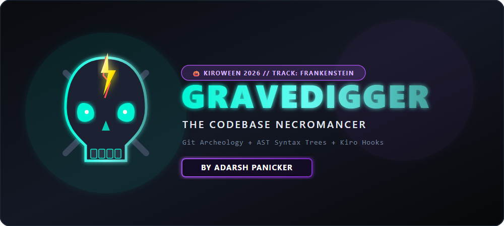
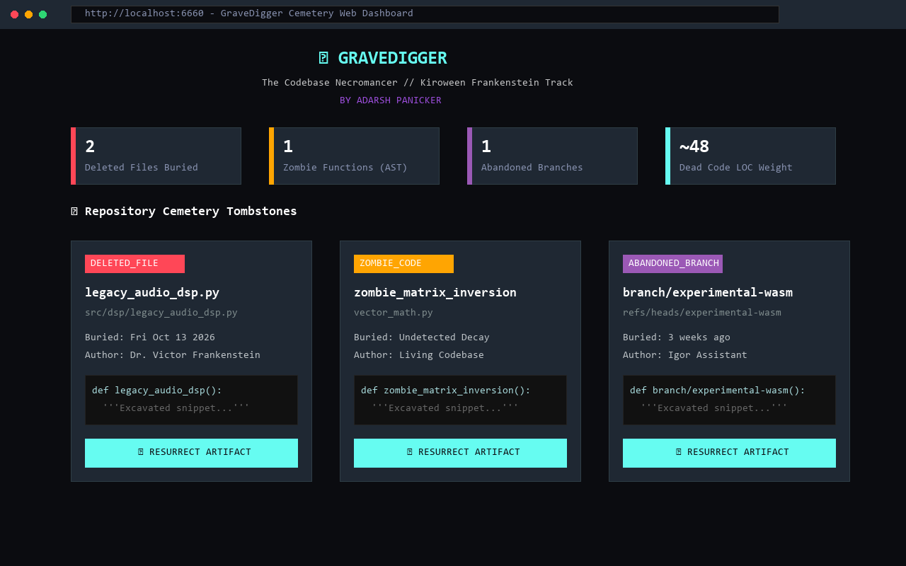
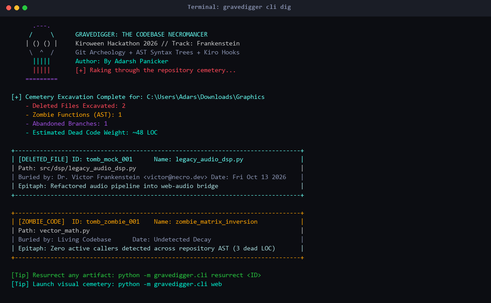

<div align="center">

# ⚡ GraveDigger: The Codebase Necromancer

<p align="center">
  
</p>

### **Created by Adarsh Panicker**

**Kiroween Hackathon 2026 Submission** | **Track:** Frankenstein 🧟  
*Stitching Git forensic plumbing, AST syntax trees, Kiro agent hooks, and gothic UI into one chimera.*

[](LICENSE)
[](https://kiroween.devpost.com/)
[](.kiro/)
[](https://www.python.org/)
[](https://gravedigger-necromancer.vercel.app/)

### 🌐 **[Launch Live Web Dashboard → gravedigger-necromancer.vercel.app](https://gravedigger-necromancer.vercel.app/)**

</div>

---

## 🎯 What GraveDigger Does (Judge & User Guide)

**GraveDigger** is an automated dead-code archeologist and resurrection tool. When you point it at a software repository, it performs three things:
1. **Excavates Deleted Files (`DELETED_FILE`):** Mines Git history (`git log --diff-filter=D`) to find files that were previously deleted, who deleted them, when, and why (commit message).
2. **Detects Zombie Functions (`ZOMBIE_CODE`):** Parses every Python file's Abstract Syntax Tree (`ast`) to find functions that are defined in the codebase but **never called anywhere**.
3. **Resurrects Dead Code into Git Patches:** With one click (or CLI command), it recovers the buried code and generates a ready-to-apply unified `.patch` file (`--- /dev/null`, `+++ b/...`) so developers can restore lost utilities cleanly.

### How to Test the Live Web Dashboard (Any Repo or Code!)
1. Open **[https://gravedigger-necromancer.vercel.app/](https://gravedigger-necromancer.vercel.app/)** (no login required).
2. **Test Any Public GitHub Repository:** Paste any public GitHub URL (e.g. `https://github.com/pallets/flask` or click the quick-try buttons) and click **`⛏️ Excavate GitHub Repo`** to scan its recent deleted commits and Python AST live.
3. **Test Your Own Python Code:** Click **`📝 Paste Python Code`**, paste any Python snippet, and click **`🧟 Scan Pasted Python Code`** to immediately detect uncalled zombie functions.
4. **Resurrect Artifacts:** Click **`⚡ Resurrect Artifact`** on any tombstone card to run `POST /api/resurrect` and view the generated **unified Git `.patch`** ready for `git apply`.

> **Note:** On the hosted Vercel serverless environment, `git` history is unavailable so GraveDigger automatically activates its **Cemetery Sandbox Mode** for deleted files while running live AST scans on the repository. To excavate full Git commit history on any real local repository, use the CLI quickstart below.

---

## 🪦 The Frankenstein Chimera

Every software repository eventually degrades into a cemetery of dead code:
1. **Buried Files:** Deleted utilities and feature modules lost in deep Git history.
2. **Zombie Code:** Functions, classes, and helpers defined in the codebase that have **zero references** anywhere across the AST.
3. **Abandoned Branches:** Experimental or abandoned branches gathering digital dust.

**GraveDigger** stitches together four disparate technologies into an autonomous developer co-pilot:
* ⛏️ **Low-Level Git Forensic Plumbing:** Uses `diff-filter=D`, tree-deltas, and reflog mining to excavate buried code without clone bloat.
* 🧠 **Static AST Syntax Analysis:** Parses code into Abstract Syntax Trees to detect unreferenced living-dead symbols and compute dead code weight.
* 🤖 **Kiro Agent Hooks & Steering Engine:** Automates event-driven audits on `PostFileSave` and guards against commit bloat on `PreCommit`.
* 🦇 **Gothic TUI & Cemetery Web Dashboard:** An atmospheric, dark-crypt UI with interactive tombstone cards and instant one-click code resurrection.

---

## 📸 Screenshots & Visual Interface

### 🌐 1. The Interactive Cemetery Web Dashboard
> *Browse repository tombstones, inspect dead code snippets, and resurrect artifacts into clean Git patches with a single click.*

<div align="center">
  
</div>

---

### 💻 2. The Gothic Terminal User Interface (TUI)
> *Terminal excavation output displaying excavated tombstones, causes of death, and dead code line count.*

<div align="center">
  
</div>

---

## 🏗️ The `/.kiro/` Architecture

GraveDigger strictly follows the mandatory Kiro spec-driven development guidelines:

```
/.kiro/
├── steering/
│   ├── architecture.md       # High-level system context, AST models, and flows
│   └── conventions.md        # Codebase standards, typing, and Kiro compliance
├── specs/
│   └── gravedigger-core/
│       ├── requirements.md   # Functional specs & user stories
│       ├── design.md         # Technical architecture & JSON models
│       └── tasks.md          # Sequenced execution checklist
└── hooks/
    ├── post-file-save.json   # Auto-detects zombie routines on file save
    └── pre-commit-audit.json # Blocks burial of critical functions before commit
```

---

## 🚀 Quickstart & Verification

GraveDigger runs on pure Python 3.10+ with zero external runtime dependencies.

### 1. Run the Unit Test Suite
```bash
python -m unittest discover -s tests
```
*(Status: `Ran 3 tests in 0.063s — OK`)*

### 2. Run the Live Demonstration
```bash
python run_demo.py
```

### 3. CLI Commands

#### 🪦 Excavate the Graveyard
```bash
python -m gravedigger.cli dig
```

#### ⚡ Resurrect a Dead Artifact
```bash
python -m gravedigger.cli resurrect tomb_mock_001
```
*Restores the buried file into `resurrected/` and generates a unified `.patch` ready for git pull request submission.*

#### 🧟 Scan AST for Living-Dead Zombie Code
```bash
python -m gravedigger.cli zombies
```

#### 🌐 Launch the Interactive Web Dashboard
```bash
python -m gravedigger.cli web --port 6660
```
*Opens `http://localhost:6660` with a dark-crypt UI, tombstone cards, and live resurrection diff previews.*

#### 🛡️ Kiro Hook Audit (CI / Git Hook Mode)
```bash
python -m gravedigger.cli audit --strict
```

---

## ⚖️ License & Attribution
* **Author:** Adarsh Panicker
* **License:** [MIT License](LICENSE)
